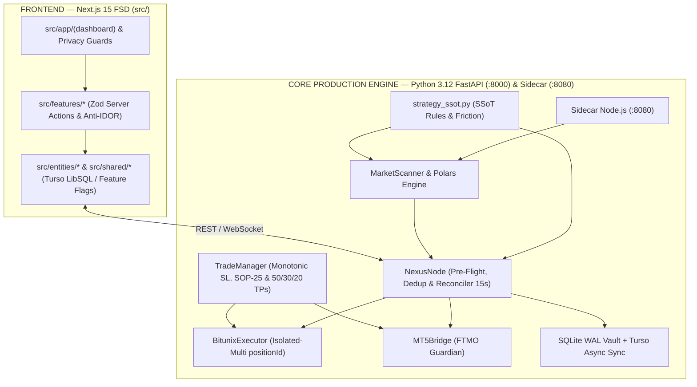

# Slingshot v10.0.0 — Quantitative Execution & Telemetry Platform

> Plataforma full-stack de análisis estructural (Smart Money Concepts + microestructura L2) y ejecución automatizada para **Bitunix Perpetual Futures** y **MetaTrader 5 (FTMO)**. Construida con separación estricta entre el frontend **Next.js 15 (Feature-Sliced Design)**, un **Sidecar WebSocket en Node.js (`:8080`)** y el motor de ejecución en **Python 3.12 / FastAPI (`:8000`) + Polars**.  
> Gobernanza y especificaciones técnicas en [`AGENTS.md`](AGENTS.md), [`BLUEPRINT_2026.md`](docs/architecture/BLUEPRINT_2026.md) y [`ESTRUCTURA_PROYECTO.md`](docs/ESTRUCTURA_PROYECTO.md).


---

## 1. Arquitectura del Sistema: Núcleo de Producción vs. Módulos de Investigación

Para mantener trazabilidad técnica y evitar mezclar componentes críticos de ejecución con módulos experimentales, el repositorio divide claramente ambas capas:

### 1.1 Core Production Engine (Camino Crítico Determinista)

| Capa | Módulos Principales | Responsabilidad en Producción |
| :--- | :--- | :--- |
| **Ingesta & Ticks L2** | `sidecar/index.js`, `engine/indicators/polars_engine.py` | Captura de streams WebSocket y cálculo vectorizado en Polars de estructura (Order Blocks, FVG, VWAP, ATR, KER, ADX y desbalance L2 OBI). |
| **Gobernanza Estratégica SSoT** | `engine/core/strategy_ssot.py`, `engine/core/session_manager.py` | Universo canónico de 13 activos, matriz `Activo:Timeframe` (`15m` / `1h`), filtros horarios y constantes empíricas de fricción (`SOP-119`). |
| **Orquestación & Pre-Flight** | `engine/execution/nexus.py`, `engine/workers/market_scanner.py` | Deduplicación de órdenes (`SOP-50`), validación de distancia límite y TTL (`SOP-131`), auditoría de libro L2 (`SOP-108`) y control de cupos concurrentes (`SOP-97`). |
| **Ejecución & Custodia en Vivo** | `engine/execution/bitunix_executor.py`, `engine/execution/mt5_bridge.py`, `engine/execution/account_manager.py` | Colocación de órdenes con SL y TP nativos desde el milisegundo 0 (`SOP-117`), aislamiento por `positionId` en modo `Isolated-Multi` (`SOP-144`), validación geométrica no destructiva (`SOP-145`) y cifrado de credenciales AES-256 Fernet (`SOP-57`). |
| **Gestión Activa de Posiciones** | `engine/workers/trade_manager.py`, `engine/core/vault.py` | Ratchet monótono de Stop Loss (`SOP-11`, jamás retrocede), invalidación temprana a `-0.65R` (`SOP-25`), avance a Breakeven + buffer de comisiones, malla 50/30/20 y persistencia ACID de hitos en SQLite WAL (`SOP-116`). |
| **Frontend Multi-Tenant FSD** | `src/app/`, `src/features/`, `src/entities/`, `src/shared/` | Jerarquía unidireccional `app -> features -> entities -> shared`, Server Actions con validación Zod, aislamiento Anti-IDOR en Turso/Drizzle y modo privacidad reversible (`featureFlags.ts`). |

### 1.2 Research & Experimental Telemetry Modules (No Bloqueantes)

Los siguientes módulos operan como **telemetría analítica o investigación fuera del camino crítico de seguridad** (ninguno de ellos puede anular los límites de riesgo ni modificar un Stop Loss defensivo):
* **Calibración Bayesiana & Clasificador HMM (`engine/core/bayesian_confluence.py`, `engine/agents/regime_hmm.py`):** Ajuste adaptativo experimental de pesos de confluencia y detección probabilística de régimen.
* **Analizadores de Escenarios e Incubadora (`engine/analytics/multi_year_regime_analog_orchestrator.py`, `engine/workers/asset_incubator.py`):** Comparación heurística de fases de mercado y evaluación rodante de activos candidatos.
* **Integración AI-Q / Post-Mortem LLM (`engine/aiq/`, `engine/agents/post_mortem_agent.py`):** Síntesis asistida por modelos de lenguaje y memoria semántica sobre la bitácora SQLite WAL.
* **Asignador HRP (`engine/risk/hrp_allocator.py`):** Investigación de paridad de riesgo jerárquica para carteras multi-activo.



---

## 2. Ingeniería de Ejecución y Protecciones Operativas Reales

Las reglas de ejecución nacieron de incidentes reales de microestructura y operación en vivo documentados en [`BLUEPRINT_2026.md`](docs/architecture/BLUEPRINT_2026.md):

1. **Invarianza Monótona de Stop Loss (`SOP-11` & `SOP-116`):** El Stop Loss solo puede moverse en dirección favorable para reducir riesgo o asegurar ganancia. Cada hito (`SOP-25`, `FAST_BE`, `TP1`, `TP2`, `TP3`) se persiste transaccionalmente en SQLite WAL (`trade_dispatched_milestones`) para sobrevivir reinicios del proceso o del servidor sin retroceder estados.
2. **Aislamiento Estricto por `positionId` en Bitunix `Isolated-Multi` (`SOP-118` & `SOP-144`):** Cuando coexisten múltiples posiciones abiertas del mismo par (ej. dos operaciones simultáneas en `XRPUSDT` o `TIAUSDT`), el reconciliador de `NexusNode` y `TradeManager` indexan cada posición por `f"{acc_id}_{symbol}_{position_id}"`, asignando su Stop Loss y su malla 50/30/20 de Take Profits de forma independiente y prohibiendo cancelaciones globales mientras existan posiciones hermanas activas.
3. **Pre-Validación Geométrica No Destructiva (`SOP-143` & `SOP-145`):** Antes de adoptar un plan histórico de `vault` para una posición detectada en el exchange, `_is_plan_geometrically_valid()` verifica que el precio de entrada coincida ($\pm 2\%$) y que el Stop Loss esté del lado defensivo correcto. Las rutinas de adopción y *auto-healing* operan con `allow_emergency_close=False`, impidiendo que un plan obsoleto dispare cierres a mercado sobre posiciones manuales o recién abiertas.
4. **Calibración Dinámica de Reloj contra el Exchange (`SOP-116`):** Sincronización continua mediante el header `req-arrive-time` de Bitunix para evitar rechazos de firma criptográfica (`code 100007`) por deriva de reloj NTP en Windows Server.
5. **Reconciliación Activa y Guardián de Universo (`SOP-113` & `SOP-117`):** Cada 15 segundos se audita que toda posición canónica abierta posea órdenes de protección activas en el libro del exchange; cualquier posición manual fuera del universo auditado se reporta por Telegram sin alterar su margen ni asignarle Stop Loss a ciegas.

---

## 3. Validación Cuantitativa, Sesgo de Selección y Pruebas Fuera de Muestra (`SOP-146`)

Todos los resultados que siguen son reproducibles ejecutando:

```bash
python -m engine.backtest.scientific_validation_suite
```

El artefacto completo se exporta en [`engine/backtest/reports/scientific_validation_report.json`](engine/backtest/reports/scientific_validation_report.json) a partir de la bitácora cronológica de 180 días ([`chronological_backtest_report.json`](engine/backtest/reports/chronological_backtest_report.json)).

### 3.1 Split Temporal Estricto In-Sample (60%) vs. Out-of-Sample (40%) en `1.0R` Plano

Para aislar la ventaja estructural de las reglas de entrada/salida respecto de cualquier multiplicador de *position sizing*, la tabla principal evalúa todas las operaciones con **riesgo fijo de `1.0R` por operación** (`sizing_mult = 1.0`), con y sin el modelo de fricción empírica en vivo `SOP-119` (tasa de llenado límite `96.2%`, *haircut* de `11.6%` por comisiones/funding en ganadoras y `-0.04R` de slippage adicional en Stop Loss):

| Segmento Temporal | Muestra ($N$) | Modo de Evaluación | Win Rate | Profit Factor | Retorno Total ($R$) | Expectativa ($\mathbb{E}[R]$) | Error Estándar ($\text{SE}_R$) | Intervalo Confianza 95% ($\text{IC}_{95\%}$) | Max Drawdown ($R$) |
| :--- | :---: | :--- | :---: | :---: | :---: | :---: | :---: | :---: | :---: |
| **Muestra Completa (180d)** | 262 | `1.0R` Plano Teórico | 51.53% | **2.22** | `+100.55 R` | `+0.384 R` | `0.066 R` | `[+0.255 R, +0.512 R]` | `-5.28 R` |
| **Muestra Completa (180d)** | 262 | `1.0R` + Fricción `SOP-119` | 50.38% | **1.87** | `+73.74 R` | `+0.281 R` | `0.061 R` | `[+0.163 R, +0.400 R]` | `-6.01 R` |
| **In-Sample (Primeros 60%)** | 157 | `1.0R` Plano Teórico | 49.68% | **2.09** | `+55.89 R` | `+0.356 R` | `0.086 R` | `[+0.188 R, +0.524 R]` | `-5.28 R` |
| **In-Sample (Primeros 60%)** | 157 | `1.0R` + Fricción `SOP-119` | 47.77% | **1.70** | `+37.61 R` | `+0.240 R` | `0.079 R` | `[+0.084 R, +0.395 R]` | `-6.01 R` |
| **Out-of-Sample (Últimos 40%)** | 105 | `1.0R` Plano Teórico | 54.29% | **2.45** | `+44.66 R` | `+0.425 R` | `0.102 R` | `[+0.225 R, +0.625 R]` | `-2.05 R` |
| **Out-of-Sample (Últimos 40%)** | 105 | `1.0R` + Fricción `SOP-119` | 54.29% | **2.18** | `+36.12 R` | `+0.344 R` | `0.094 R` | `[+0.159 R, +0.529 R]` | `-2.45 R` |

### 3.2 Cuantificación Transparente del Sesgo de Supervivencia (*15 Activos Sin Podar vs. 13 Canónicos*)

Los activos `AVAXUSDT` y `RENDERUSDT` (así como ciertas combinaciones `Activo:Timeframe`) fueron excluidos tras observar su bajo rendimiento en la ventana histórica de 180 días. Dado que esa selección se realizó sobre la misma muestra (*in-sample selection bias*), reportamos ambas métricas lado a lado:

| Universo Evaluado | Muestra ($N$) | PF (`1.0R` Teórico) | $\mathbb{E}[R]$ (`1.0R` Teórico) | PF (`1.0R` + Fricción `SOP-119`) | $\mathbb{E}[R]$ (`1.0R` + Fricción) | $\text{IC}_{95\%}$ (con Fricción) | Max DD ($R$, con Fricción) |
| :--- | :---: | :---: | :---: | :---: | :---: | :---: | :---: |
| **Universo Bruto Sin Podar (15 Activos)** | 335 | **1.65** | `+0.247 R` | **1.39** | `+0.153 R` | `[+0.045 R, +0.262 R]` | `-22.41 R` |
| **Universo Canónico Podado (13 Activos)** | 262 | **2.22** | `+0.384 R` | **1.87** | `+0.281 R` | `[+0.163 R, +0.400 R]` | `-6.01 R` |
| **Delta por Selección In-Sample** | -73 | `+0.57` | `+0.137 R` | `+0.48` | `+0.128 R` | — | `-16.40 R` |

> **Conclusión metodológica:** La poda de activos explica `+0.48` puntos del Profit Factor bajo fricción. Aun sin aplicar dicha poda (universo bruto de 15 activos), la estrategia mantiene una expectativa positiva estadísticamente significativa ($t = 2.77$, límite inferior $\text{IC}_{95\%} = +0.045\text{R}$), aunque con un drawdown sustancialmente mayor (`-22.41R`). La validez real de conservar el universo de 13 activos solo puede confirmarse en el *forward-test* en vivo.

### 3.3 Matriz de Sensibilidad de Parámetros ($\pm 10\%$ y $\pm 20\%$)

Para descartar que el resultado dependa de un punto crítico frágil (*cliff overfitting*), se perturbaron simultáneamente el umbral de invalidación temprana (`SOP-25`: `-0.65R`), la distancia de los objetivos Take Profit y la severidad de la fricción `SOP-119`:

| Perturbación de Parámetros | Factor de Escala | PF (`1.0R` Plano) | $\mathbb{E}[R]$ (`1.0R` Plano) | PF (`1.0R` + Fricción `SOP-119`) | $\mathbb{E}[R]$ (`1.0R` + Fricción) | Límite Inferior $\text{IC}_{95\%}$ | Max DD ($R$) |
| :--- | :---: | :---: | :---: | :---: | :---: | :---: | :---: |
| **$-20\%$** | `0.80x` | 2.22 | `+0.306 R` | **1.87** | `+0.224 R` | `+0.129 R` | `-4.81 R` |
| **$-10\%$** | `0.90x` | 2.22 | `+0.345 R` | **1.87** | `+0.253 R` | `+0.146 R` | `-5.41 R` |
| **Base ($0\%$)** | `1.00x` | 2.22 | `+0.384 R` | **1.87** | `+0.281 R` | `+0.163 R` | `-6.01 R` |
| **$+10\%$** | `1.10x` | 2.04 | `+0.357 R` | **1.56** | `+0.198 R` | `+0.082 R` | `-8.44 R` |
| **$+20\%$** | `1.20x` | 1.85 | `+0.319 R` | **1.30** | `+0.115 R` | `+0.002 R` | `-12.18 R` |

* **Parameter Stability Score:** `0.735 / 1.000` (Profit Factor mínimo de `1.30` en el extremo más adverso de $+20\%$ de fricción y alejamiento de objetivos).

### 3.4 Estudio de Ablación (*Ablation Study* por Capa)

| Configuración Evaluada | PF In-Sample (60%) | $\mathbb{E}[R]$ In-Sample | PF Out-of-Sample (40%) | $\mathbb{E}[R]$ Out-of-Sample | Max DD Full Sample ($R$) |
| :--- | :---: | :---: | :---: | :---: | :---: |
| **1. Baseline SMC Puro (`1.0R` Plano, Sin Multiplicadores)** | 2.09 | `+0.356 R` | **2.45** | `+0.425 R` | `-5.28 R` |
| **2. Baseline SMC + Fricción Real `SOP-119`** | 1.70 | `+0.240 R` | **2.18** | `+0.344 R` | `-6.01 R` |
| **3. Baseline SMC + Escudo de Racha (`SOP-94` Only)** | 2.14 | `+0.320 R` | **2.32** | `+0.362 R` | `-4.64 R` |
| **4. Stack con Alpha-Tier Sizing (Trinidad + Horarios)** | 2.27 | `+0.441 R` | **2.58** | `+0.523 R` | `-6.87 R` |

> **Observación del Ablation Study:** El *edge* proviene mayoritariamente del **Baseline SMC Puro en `1.0R` plano** (malla de salidas 50/30/20 + corte temprano `SOP-25` + filtro macro BTC). El Escudo de Racha (`SOP-94`) reduce el Max Drawdown de `-5.28R` a `-4.64R` a cambio de una ligera reducción de expectativa bruta, mientras que el *Alpha-Tier Sizing* incrementa el retorno total en $R$ pero también eleva la varianza ($\sigma_R$ sube de `1.06R` a `1.32R`) y el drawdown en $R$ (`-6.87R`).

---

## 4. Limitaciones Estadísticas Conocidas, Perfil de Riesgo y Forward-Test en Vivo

1. **Tamaño de Muestra e Incertidumbre Muestral:** Con $N = 262$ operaciones en 180 días ($N_{\text{OOS}} = 105$), el error estándar bajo fricción es $\text{SE}_R = 0.061\text{R}$ ($\text{IC}_{95\%} = [+0.163\text{R}, +0.400\text{R}]$). Aunque es estadísticamente distinto de cero ($t = 4.64$), una muestra de 6 meses en cripto no captura todos los regímenes macro posibles.
2. **Alcance Real del Monte Carlo (`engine/analytics/monte_carlo_resilience_engine.py`):** El motor Monte Carlo ejecuta tanto *i.i.d. Bootstrap* como *Circular Block Bootstrap ($b=5$)* sobre los retornos históricos para estimar el **riesgo de secuencia (*path risk*) y drawdowns de cola (P95 / P99)** condicionados a esa muestra. **No prueba ni garantiza rentabilidad fuera de muestra.**
3. **Perfil de Riesgo Operativo Configurado (`2.50%` en Bitunix / `0.75%` en FTMO MT5):**
   * En **Bitunix Futures**, la cuenta principal opera por defecto con un riesgo agresivo de **`2.50%` por operación** (`BITUNIX_BASE_RISK_PCT=0.025`, configurable en `.env`), orientado a crecimiento sobre capital propio con límite de 2 posiciones desprotegidas simultáneas (`SOP-97`) y mínimo 50% de margen libre (`SOP-40`).
   * En **FTMO / MetaTrader 5**, el riesgo se restringe a `0.75%` en Fase 1, `0.50%` en Fase 2 y `0.35%` en cuenta fondeada, con *kill-switch* diario a `-3.5%`.
4. **Auditoría Continua de Forward-Test vs. Backtest (`engine/analytics/live_forward_tracker.py`):**
   * El módulo `LiveForwardTracker` compara las operaciones reales cerradas en producción desde la fecha de congelamiento de parámetros (`PARAMETER_FREEZE_DATE`) contra la expectativa con fricción (`+0.281R`), midiendo el *Implementation Shortfall* real (slippage de llenado en bps, comisiones y funding reales) y emitiendo una alerta de degradación estadística si el *z-score* cae por debajo de `-2.0`.

---

## 5. Instalación, Verificación y Despliegue

### 5.1 Requisitos e Inicio Local
1. Copiar `.env.example` a `.env` (y `.env.local` para el frontend) completando credenciales y variables de servidor (`SLINGSHOT_VPS_IP`, `BACKEND_INTERNAL_URL`, `NEXT_PUBLIC_API_URL`, `TURSO_DATABASE_URL`).
2. Instalar dependencias y levantar servicios:

```bash
# Frontend Next.js 15 (Puerto 3000)
npm install
npm run dev

# Motor Python FastAPI (Puerto 8000)
python -m uvicorn engine.api.main:app --host 0.0.0.0 --port 8000
```

### 5.2 Suite de Verificación y Quality Gates
Ningún cambio puede desplegarse sin pasar las cuatro verificaciones automatizadas:

```powershell
# 1. Higiene SSoT y Escáner OpSec Zero-Leak (SOP-146)
python scripts/diagnostic/check_hygiene.py

# 2. Compilación TypeScript estricta y Tests Unitarios/FSD Frontend (Vitest)
npm run typecheck
npm test

# 3. Suite Cuantitativa y de Ejecución Backend (Pytest)
pytest engine/tests/

# 4. Suite de Validación Científica Out-of-Sample, Sensibilidad y Ablación
python -m engine.backtest.scientific_validation_suite
```

### 5.3 Despliegue Remoto y Auditoría en Vivo del VPS (`SOP-120`)
Los scripts de despliegue en `scripts/deploy/` leen `SLINGSHOT_VPS_IP`, `SLINGSHOT_VPS_PORT`, `SLINGSHOT_VPS_USER` y `SLINGSHOT_VPS_PASS` exclusivamente desde `.env` local (nunca hardcoded en el repositorio):

```powershell
# Sincronización GitOps, reciclaje de servicios y verificación de la tríada operativa
powershell -File scripts/deploy/deploy_and_verify_vps.ps1

# Auditoría rápida de procesos vivos y logs sin reinicio
powershell -File scripts/deploy/sync_and_audit_vps.ps1
```
